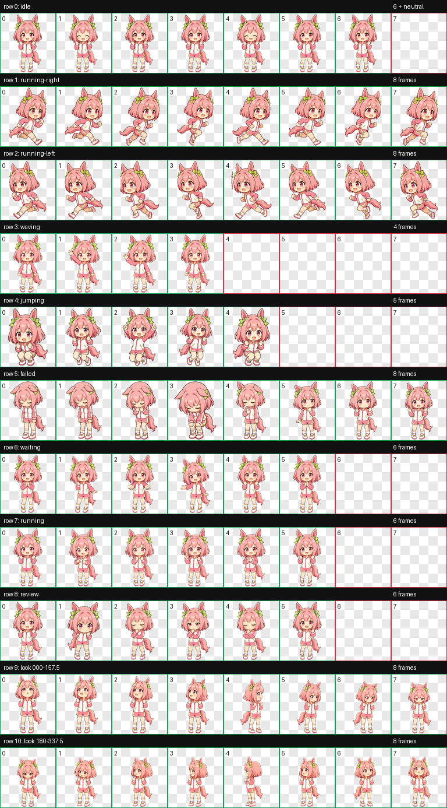
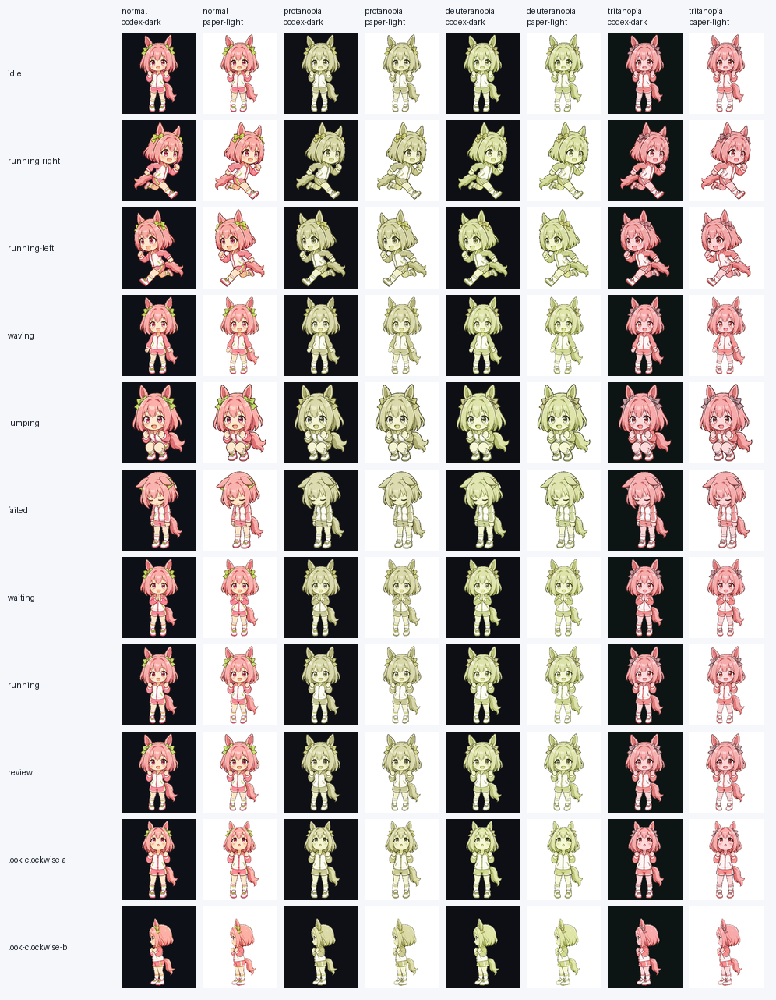

# Haru Urara Codex Pet

[](https://github.com/KanadeK/haru-urara-codex-pet/actions/workflows/ci.yml)
[](https://github.com/KanadeK/haru-urara-codex-pet/actions/workflows/security.yml)
[](https://github.com/KanadeK/haru-urara-codex-pet/releases/latest)
[](pyproject.toml)

**A cheerful Haru Urara desktop pet for Codex—and a real visual QA toolkit for
every Codex pet.**

[简体中文](README.zh-CN.md) · [PetSight](docs/PETSIGHT.md) ·
[architecture](docs/ARCHITECTURE.md) · [research](docs/RESEARCH.md) ·
[troubleshooting](docs/TROUBLESHOOTING.md)



This repository is intentionally more than a sprite download. It ships:

- a complete Codex v2 pet with 74 populated cells (73 animation/direction frames
  plus one neutral look frame), 14 transparent unused cells, nine task states,
  and 16 clockwise look directions;
- **PetSight**, a pixel-level audit across normal, protanopia, deuteranopia, and
  tritanopia views on dark and light backgrounds;
- a deterministic, traversal-safe `.codex-pet` packager;
- an atomic installer with locking, validation, backups, drift diagnosis,
  repair, uninstall, and restore;
- machine-readable JSON reports, a PNG scenario matrix, and an HTML audit;
- tests, type checking, linting, reproducible release gates, and CI on Windows
  and Linux.

Haru Urara fits the project unusually well: the character is known for
cheerful persistence, while Codex tasks naturally move through running,
waiting, review, and recovery states. The selection was grounded in official
character material, current popularity evidence, and a dated GitHub duplicate
search; see [`docs/RESEARCH.md`](docs/RESEARCH.md).

## Install

### From a release

Download the wheel and `haru-urara.codex-pet` from the
[latest release](https://github.com/KanadeK/haru-urara-codex-pet/releases/latest),
then run:

```bash
python -m pip install haru_urara_codex_pet-0.1.0-py3-none-any.whl
urara-pet verify-archive haru-urara.codex-pet
urara-pet install --source haru-urara.codex-pet
urara-pet doctor --source haru-urara.codex-pet
```

The wheel also bundles the verified pet, so `urara-pet install` works without
`--source`.

Restart Codex after installation if the pet picker does not refresh
immediately.

### From source

```bash
git clone https://github.com/KanadeK/haru-urara-codex-pet.git
cd haru-urara-codex-pet
python -m venv .venv
python -m pip install -e ".[dev]"
urara-pet validate
urara-pet audit --matrix-out build/petsight-matrix.png \
  --json-out build/petsight-report.json \
  --html-out build/petsight-report.html
urara-pet install
```

On Windows PowerShell, activate with
`.venv\Scripts\Activate.ps1`; on macOS or Linux, use
`source .venv/bin/activate`.

## PetSight

PetSight reads the actual final atlas. It does not grade filenames or display a
decorative dashboard.

```bash
urara-pet audit pet/haru-urara \
  --policy examples/petsight-policy.json \
  --matrix-out build/petsight-matrix.png \
  --json-out build/petsight-report.json \
  --html-out build/petsight-report.html
```

It checks:

- manifest types, v2 geometry, 74 populated cells, 14 unused cells, hidden RGB,
  opaque chroma residue, and safe atlas paths;
- 10th-percentile outline contrast in eight perception/background scenarios;
- frame coverage, visible-area variation, baseline stability, duplicate frames,
  and state-level motion;
- deterministic JSON/HTML evidence suitable for CI and release review.

Policies are JSON and can be tightened without changing code. See
[`examples/petsight-policy.json`](examples/petsight-policy.json) and
[`docs/PETSIGHT.md`](docs/PETSIGHT.md).



## Safe lifecycle

Every mutating operation validates first and keeps recovery information:

```bash
# Detect missing files or byte drift
urara-pet doctor --source haru-urara.codex-pet

# Repair from a verified source; the old installation is backed up
urara-pet repair --source haru-urara.codex-pet

# Remove by moving to a verified backup
urara-pet uninstall

# Restore the newest valid backup
urara-pet restore
```

Archives are rejected before extraction if they contain traversal paths,
absolute paths, duplicate members, symlinks, unexpected files, or excessive
expanded size.

## Acceptance

The repository-level acceptance command is:

```bash
python scripts/verify.py
```

It runs:

1. Ruff;
2. strict Mypy;
3. the full pytest suite with branch coverage;
4. v2 pet validation and PetSight;
5. deterministic package comparison across deliberately separated builds;
6. archive inspection, wheel/sdist inspection, secret scanning, and
   documentation-link checks.

For a faster local loop:

```bash
python -m pytest -q
python -m ruff check .
python -m mypy src
urara-pet validate pet/haru-urara
```

If acceptance fails, use the exact issue code printed by the command and the
repair table in [`docs/TROUBLESHOOTING.md`](docs/TROUBLESHOOTING.md). Do not
silence a visual threshold or copy a different animation frame into a failing
slot.

## Release artifacts

Each tagged release contains:

- `haru-urara.codex-pet` — flat installer archive;
- `haru-urara-codex-pet-vX.Y.Z.zip` — folder-preserving pet archive;
- Python wheel and source distribution;
- `petsight-report.json`, `petsight-report.html`, and
  `petsight-matrix.png`;
- `SHA256SUMS`.

All ZIP timestamps are fixed and release payloads are built twice with a pause
before byte comparison. See [`docs/RELEASE.md`](docs/RELEASE.md).

## Fan-project notice

This is an unofficial, non-commercial fan project. It is not affiliated with
Cygames or OpenAI. The MIT license applies to original software and
documentation, not to third-party character rights. Read
[`ASSET_TERMS.md`](ASSET_TERMS.md) before reusing character assets.
